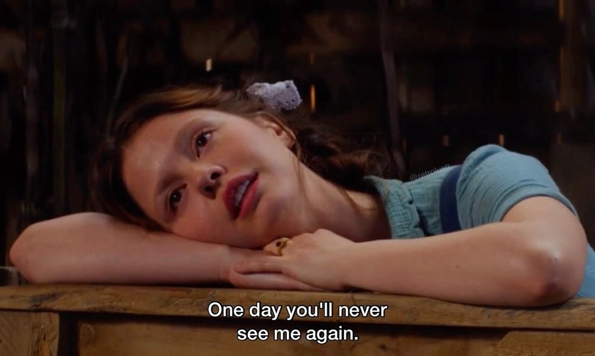

+++

title = "朋友"
date = 2026-11-02T09:00:00+08:00
draft = false
tags = ["日常"]

+++

这个词很奇怪，好像一个有时效性的词。很熟悉，因为有一首歌就叫做「朋友」，填充了慢慢的情感，特别是在合唱的时候，就会让人情不自禁深陷其中的。即使身边的人可能并不是朋友。

<!--more-->

周日的时候，带孩子从外面回到家，便问了一句周末没怎么见过跟小孩玩的邻居小孩。一时竟然不知道应该称他们之间的关系是什么，朋友？玩伴？小伙伴？好像都不太对，又好像都可以。想起前天跟一朋友坐在宵夜摊上喝酒期间谈起的话题，我俩认识以前还是初中的同学，因为一些机缘巧合的原因而在如今还坐在同一起面对面胡言乱语，或许是因为足够的缘分在支撑着。也许更多的是因为酒精更让人迷糊，让人更加容易褪去羞涩去表达情绪。也许，这就是很容易让外人觉得喝醉的人比较煽情，或许，人的本性就是如此呢？只不过是日常的谋生让人不得不披上能够让自己在日常生活中披荆斩棘的铠甲，抵挡日常的所有脆弱情感。

好像自己的朋友在初中毕业后就已经成为了历史。即使初中时候也有一些一起玩耍的人，但是几年过去后，发现大家都消失在这个庞大的社会。也许就是在身边，但是因为秉性或者求生，暇不顾己，哪有什么多余的精力去照顾一个久远的朋友？志不投趣不同不以为道。

当然，因为生活中遇到的一些事情也让自己开始刻意去关注朋友的定义。其一就是日常工作中遇到的同行，发现也许很多的观念并没有那么和谐，反倒存在着各种各样的瑕疵，只不过因为同一个目的或者短暂地存在交集而度过一段以为朋友相处的时光。不管其来自哪里或者之前的经历是如何的相似，好像都没有那么容易被朋友一次以特别的理由收编在一起。反而更像是萍水相逢，一拍即散。相逢是偶然，分开各不理会才是自然。对类似的种种，反而那样觉得一种惋惜的情绪，更加释然。付出的是就是学费，没有什么路是青云直上的。那么，就当作是一种体验，虽然可以说是一种不幸的体验。

回到孩子的玩伴身上，发动之前在相册的抓拍照片，虽然 X 说她们好像是天生的一对小朋友。在几次的玩耍之后，自我感受并没有那种强烈的感受，也许是现代的一种城市的环境带来的疏离，少了很多的能够将人推向彼此的游戏以及活动。当然，具体未来的走向，还是看她们彼此的造化。

朋友是什么？就是相互情感流通的通道。回忆相处的时间，心里也曾有过五味杂陈甚至惋惜。在人生很长的时间里，「朋友」就像是一道甜点一样。